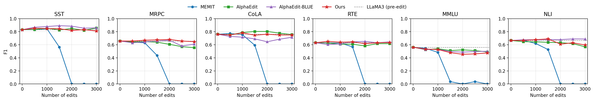

# Llama-3-8B 일반 능력 6과제 F1 (AlphaEdit Figure 3 형식), 0–3,000건

2026-10-11 20:15 KST 완료. 사용자 요청: "llama ours를 3k까지 돌려서 … Figure 3: F1 scores of post-edited LLaMA3 (8B) across six tasks … memit, alphaedit, BLUE, ours … 500 edit 마다 dot을 찍어서 비교".

## 설정

- 과제: SST·MRPC·CoLA·RTE·MMLU·NLI, 생성 기준 weighted F1(그림). 대안 지표(최고 확률 답)도 `downstream-f1.json`·`.csv`에 함께 기록했다.
- 평가기: job 42706과 같은 BLUE glue_eval(과제별 rows 10–110, 0-shot, FP32). 모든 상태에서 `terminal.json`이 TERMINAL_VALID이고 metrics 파일 SHA가 일치한다.
- 표본: 네 방법 모두 fixed10k 순서의 앞 3,000건을 100건씩 순차 편집한다. Ours는 2K 본표 run(62604)을 3K로 연장한 run(server4 63238 → 63277)이다.
- 편집 상태 출처: MEMIT·AlphaEdit는 native lifelong run 42658·42657, AlphaEdit-BLUE는 39283_1(L4+L8). 1,500·2,500건 checkpoint는 원 runner로 다시 만들었다(server4 MEMIT 63283, BLUE 63284, AlphaEdit 63262; B025 저장 뒤 정지). 세 replay 모두 원 run과 25개 batch 해시가 일치한다(`compare_replay --deep`, B015·B025 MATCH).

| 평가 job | 서버 | 지점 |
| :--- | :--- | :--- |
| 63245 (job1) | devbox | W0, MEMIT·AlphaEdit 500/1000/2000/3000, Ours 500–2000 |
| 63336 (job2a) | devbox | W0, Ours 2500/3000 |
| 63529 (job2b) | server4 | W0, MEMIT·AlphaEdit·AlphaEdit-BLUE 1500/2500 |
| 42706 (기존) | — | W0, AlphaEdit-BLUE 500/1000/2000/3000 |

**W0 일치:** 네 평가의 W0는 6과제 생성·대안 F1이 모두 같다. devbox 63245와 63336은 행까지 같고, 42706은 확률값 1e-16 수준만 다르다. server4 63529(RTX PRO 6000)는 devbox(RTX A6000)와 가중치 291개 텐서 해시가 같고, 600행의 생성 문장·답·정답 여부가 모두 같다. 기록된 확률값만 최대 1.7e-5 다르다(예측 변화 없음). 그래서 server4 지점을 devbox 지점과 한 그림에 둔다.

## 6과제 평균 생성 F1

| 편집 수 | MEMIT | AlphaEdit | AlphaEdit-BLUE | Ours |
| ---: | ---: | ---: | ---: | ---: |
| 0 | 68.48 | 68.48 | 68.48 | 68.48 |
| 500 | 68.15 | 67.11 | 67.24 | **68.54** |
| 1,000 | 65.99 | 68.04 | 67.68 | **69.10** |
| 1,500 | 45.42 | 67.12 | 67.67 | **68.03** |
| 2,000 | 0.00 | 66.63 | **67.01** | 65.75 |
| 2,500 | 0.60 | 65.30 | 65.65 | **66.01** |
| 3,000 | 0.00 | 64.11 | **66.95** | 65.27 |

## 3,000건 과제별 생성 F1

| 방법 | SST | MRPC | CoLA | RTE | MMLU | NLI | 평균 |
| :--- | ---: | ---: | ---: | ---: | ---: | ---: | ---: |
| W0 | 83.11 | 65.76 | 76.07 | 63.11 | 56.24 | 66.60 | 68.48 |
| MEMIT | 0.00 | 0.00 | 0.00 | 0.00 | 0.00 | 0.00 | 0.00 |
| AlphaEdit | 85.69 | 55.59 | 75.74 | 61.79 | 48.99 | 56.89 | 64.11 |
| AlphaEdit-BLUE | 85.97 | 60.94 | 71.47 | 64.41 | 50.06 | 68.85 | 66.95 |
| Ours | 81.13 | 64.80 | 74.98 | 63.53 | 47.51 | 59.68 | 65.27 |

## 읽는 법

- MEMIT은 1,500건에서 크게 떨어지고(평균 45.42) 2,000건부터 거의 0이다. 2,000·3,000건은 6과제 모두 100개 생성 출력이 전부 invalid(답 형식 아님, 예: " Belgium,, Webster,")이고, 2,500건은 MMLU만 6개가 유효하다.
- Ours는 500·1,000·1,500·2,500건에서 평균이 가장 높고, 2,000·3,000건에서는 AlphaEdit-BLUE가 가장 높다. 3,000건 평균은 BLUE 66.95, Ours 65.27, AlphaEdit 64.11이다.
- MMLU는 1,500건부터 Ours가 세 방법 중 가장 낮다(3,000건 47.51 대 AlphaEdit 48.99·BLUE 50.06, W0 56.24). MRPC·RTE는 Ours가 W0 근처를 유지한다.
- AlphaEdit(51.14)와 BLUE(49.67)의 MMLU가 1,500·2,500건에서 같은 것은 우연이다. 두 상태는 parameter root가 다르고 MMLU 답이 각각 24개·16개 다르며 invalid 수도 다르다.

## 파일

- `downstream-f1-generation.png` sha256 `adbc12e3404e1452d01fbbb6b7f45ea564235fad71fa868a40ff547e7a024d7a`
- `downstream-f1-generation.pdf` sha256 `2651d316f8a12b5abb88d7b893d33ac203338793ac977b3812465713b77b7386`
- `downstream-f1.csv` sha256 `46e3a138754619bab415c487bd7034523a221874d65517cea7cb93c2022b0dcb`
- `downstream-f1.json` sha256 `456068f44522deb73b41048278635f064be8ed66fe2aef09e930dee1a4b27730`
- 그림 스크립트: `project/run_scripts/downstream_3k/figure.py` @ `29a8333d`(branch `codex/price-final-flucon-20261011`), 입력 우선순위 job1 → job2a → job2b-s4 → ref42706.
- 원자료: devbox `/mnt/raid5/janghj/ODE-edit/local/downstream-3k-20261011/`(`job1-output`, `job2a-output`, `job2b-output-s4`(server4에서 복사, 142개 파일 sha256 일치), `ref42706`, `figure-final`), server4 기록 `job2b-s4-records/`.
